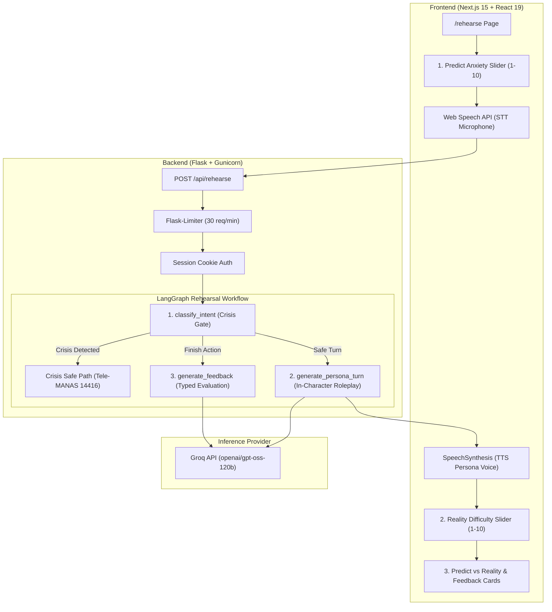

# VibeVerse — Social Rehearsal Feature Documentation

**Project Name**: VibeVerse — AI Companion for Introverted & Socially Anxious Students  
**Feature**: Social Rehearsal Mode (In-Character Roleplay, Voice I/O, Predict vs. Reality, and Structured Feedback)  
**Hackathon Presentation Ready**: Yes  

---

## 1. Executive Summary & Purpose

College students suffering from social anxiety often experience catastrophic anticipatory anxiety before everyday social interactions (ordering at a busy canteen, asking a professor a doubt, speaking up in group projects).

**The Social Rehearsal Feature** introduces an AI-powered sandbox that applies **Cognitive Behavioral Therapy (CBT) exposure techniques**:
1. **Anticipatory Forecast ("Predict")**: The student estimates how terrifying the interaction will be (1 to 10).
2. **Realistic Roleplay Simulation**: The student speaks or chats with an AI persona matching the specific scenario and chosen difficulty level (*Gentle*, *Realistic*, *Tough*).
3. **Voice Interaction**: Native browser Speech-to-Text (microphone input) and Text-to-Speech (persona speaking aloud).
4. **Reality Testing ("Reality")**: After completing the dialogue, the student rates how difficult it *actually* was.
5. **The Mindset Shift**: The system calculates the **"Anxiety Gap"** to prove quantitatively that anticipatory dread is usually 2x to 3x higher than reality.
6. **Actionable Feedback**: The AI coach delivers structured, positive reinforcement, one practical tip, and an improved opening line to practice.

---

## 2. System Architecture



---

## 3. Detailed File-by-File Changes

### 1. `backend/rag/schemas.py` (Modified)
**Location**: `VibeVerse-main/backend/rag/schemas.py`  
**Purpose**: Defines Pydantic data schemas enforcing structured LLM outputs.

**Additions**:
```python
class RehearsalTurnResponse(BaseModel):
    reply: str = Field(description="In-character response from the simulated persona.")
    tone: str = Field(description="Brief description of the persona's tone, e.g. friendly, busy, skeptical, patient.")

class RehearsalFeedback(BaseModel):
    what_went_well: str = Field(description="Specific encouragement on what the student did well (e.g. clarity, politeness, courage).")
    one_tip: str = Field(description="One actionable, practical tip to improve confidence, tone, or effectiveness next time.")
    better_opening_line: str = Field(description="An improved or alternative opening sentence the student could say in this scenario.")
```
**Why**: Ensures Groq's `gpt-oss-120b` returns structured, type-safe data that never breaks the frontend parser.

---

### 2. `backend/rag/rehearse_graph.py` (New File)
**Location**: `VibeVerse-main/backend/rag/rehearse_graph.py`  
**Purpose**: Manages the complete rehearsal state machine via **LangGraph**.

**Key Components**:
- **5 Supported College Scenarios**:
  - `canteen_order`: Campus Canteen Cashier during lunch rush.
  - `ask_professor`: Professor after lecture packing up notes.
  - `group_project`: Teammate in project discussion.
  - `introduce_self`: Peer sitting alone before lecture.
  - `presentation_qa`: Audience member asking a follow-up question.
- **3 Difficulty Tones**:
  - `gentle`: Patient, warm, supportive, gives plenty of time.
  - `realistic`: Authentic college environment, natural conversational pace.
  - `tough`: Fast-paced, rushed, or mildly skeptical.
- **LangGraph State Nodes**:
  1. `classify_intent`: Checks for self-harm or acute crisis.
  2. `safe_response`: Returns verified Indian national mental health helpline **Tele-MANAS (14416 / 1800-89-14416)** and terminates immediately without generating persona text.
  3. `generate_persona_turn`: Produces concise, natural spoken responses (1–3 sentences) in character.
  4. `generate_feedback`: Evaluates the full transcript and outputs encouragement, one practical tip, and a polished opening line.

---

### 3. `backend/app.py` (Modified)
**Location**: `VibeVerse-main/backend/app.py`  
**Purpose**: Exposes the REST API endpoints to the frontend.

**Additions**:
- `GET /api/rehearse/scenarios`: Returns available scenarios and initial starter lines.
- `POST /api/rehearse`:
  - Protected with `@login_required` (session cookie).
  - Rate-limited with `@limiter.limit("30 per minute")`.
  - Invokes `rehearsal_graph` and returns `{ reply, tone, crisis_flag, feedback }`.

---

### 4. `frontend/components/navbar.tsx` (Modified)
**Location**: `VibeVerse-main/frontend/components/navbar.tsx`  
**Purpose**: Navigation bar across the platform.

**Additions**:
- Imported `Mic` from `lucide-react`.
- Added `{ href: "/rehearse", label: "Rehearse", icon: Mic }` to `navLinks`.
- Included in both the desktop header and the mobile bottom navigation bar.

---

### 5. `frontend/app/rehearse/page.tsx` (New File)
**Location**: `VibeVerse-main/frontend/app/rehearse/page.tsx`  
**Purpose**: Complete, responsive 4-stage interactive user interface.

**Detailed Workflow**:
1. **Stage 1: Setup**:
   - **Scenario Selection Cards**: Visual selector with custom emoji, titles, and context descriptions.
   - **Difficulty Toggle**: Gentle, Realistic, Tough buttons with visual badges.
   - **Pre-Rehearsal Predict Slider**: Interactive slider (1 to 10) with dynamic labels:
     - 1–2: *Barely nervous (Breeze)*
     - 3–4: *Mild butterflies (Manageable)*
     - 5–6: *Noticeably anxious (Sweaty palms)*
     - 7–8: *High anxiety (Heart pounding)*
     - 9–10: *Extreme fear (Fight or flight)*
2. **Stage 2: Rehearsal Dialogue**:
   - Header displaying persona role, difficulty badge, and scenario context.
   - Chat transcript area with persona and student speech bubbles.
   - **Microphone Button (STT)**: Uses browser-native Web Speech API (`webkitSpeechRecognition`) with pulsing recording animation.
   - **Persona Voice (TTS)**: Automatic or replayable speech output using `window.speechSynthesis` with mute/unmute control.
   - "Finish & Get Feedback" button.
3. **Stage 3: Reality Rating**:
   - Post-rehearsal slider: "How scary did it actually feel in reality? (1 to 10)".
4. **Stage 4: Feedback & Predict vs Reality Result**:
   - **Predict vs. Reality Comparison Card**: Side-by-side score visualization.
   - **Calculated Anxiety Gap**:
     - Example: *"You predicted 7/10, but reality was 4/10! That is a 3-point anxiety gap. Your brain anticipated danger that never materialized."*
   - **Structured Feedback Cards**:
     - ✨ *What Went Well*: Highlights courage, politeness, and clarity.
     - 💡 *One Actionable Tip*: Practical advice for real-world execution.
     - 🎯 *Try Saying This Out Loud*: Model opening sentence with a "Hear It" audio button.
   - "Practice Another Scenario" reset button.

---

## 4. Key Engineering & Hackathon Highlights

1. **Evidence-Based Psychology (CBT Exposure Therapy)**:
   - Instead of just being an AI chatbot, VibeVerse acts as an **exposure therapy tool**. Comparing *Predict vs Reality* disconfirms cognitive distortions (catastrophizing).
2. **Zero Additional Cost / Zero Latency Voice**:
   - Uses native browser Web Speech APIs (`SpeechRecognition` & `SpeechSynthesis`). Does not require expensive Whisper or ElevenLabs API keys, making it resilient and 100% free.
3. **Strict Safety Guardrail**:
   - Every user turn is vetted for crisis-level distress. If triggered, the AI is bypassed entirely, immediately displaying the Indian Government's Tele-MANAS helpline.
4. **State Machine over Linear Prompt**:
   - LangGraph cleanly separates intent classification, persona simulation, and analytical feedback into distinct, typed nodes.

---

## 5. Live Hackathon Demo Script (2-Minute Walkthrough)

When presenting to judges:

1. **The Problem (20s)**:
   > *"Social anxiety makes introverted students avoid everyday college interactions — like asking a professor a doubt or ordering at the canteen. Avoidance reinforces the fear."*
2. **The Solution (20s)**:
   > *"VibeVerse provides Social Rehearsal Mode — an AI sandbox to test and disconfirm social fears using CBT exposure."*
3. **The Live Demo (60s)**:
   - Select **"Asking Professor a Question"** and set difficulty to **"Realistic"**.
   - Move the **Predict Slider** to `8/10` (*"My brain thinks I'll stutter and look foolish"*).
   - Click **Step into Scenario**. Show the persona starting the dialogue.
   - Click the **Microphone** and speak: *"Excuse me professor, could you clarify slide 4?"*
   - Listen to the persona speak back in real time.
   - Click **Finish & Get Feedback**.
   - Set the **Reality Slider** to `4/10` (*"It actually wasn't bad at all!"*).
4. **The Big Reveal (20s)**:
   - Point to the **Predict vs Reality Card**:
   > *"Notice the 4-point Anxiety Gap. VibeVerse proves to students that their catastrophic forecast was 2x scarier than the actual event."*
   - Point to the **Typed Feedback** and listen to the suggested opening line.
