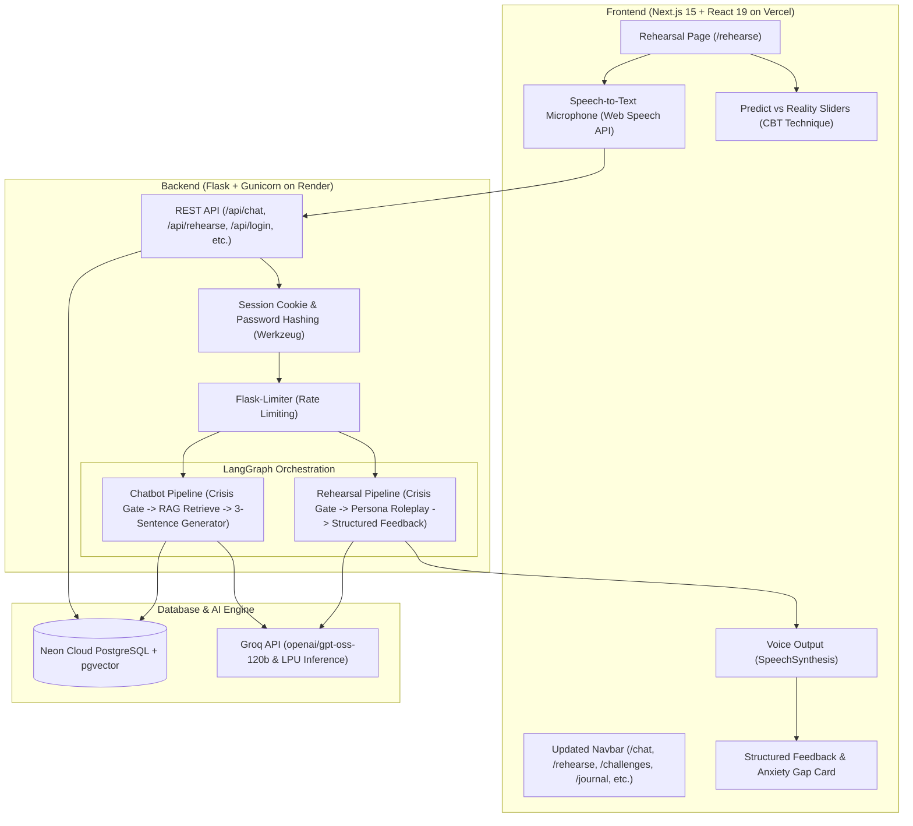

# VibeVerse — Master Project Changes & Upgrade Documentation

**Project Name**: VibeVerse — AI Companion for Introverted & Socially Anxious Students  
**Repository**: [github.com/heena-jindal/VibeVerse](https://github.com/heena-jindal/VibeVerse)  
**Live Frontend**: [https://frontend-two-sepia-yhuaaettcp.vercel.app/](https://frontend-two-sepia-yhuaaettcp.vercel.app/)  
**Live Backend API**: [https://vibeverse-yybw.onrender.com](https://vibeverse-yybw.onrender.com)  
**Documentation Version**: Complete Master Changelog (All Upgrades Verified Live)  

---

## 1. Executive Summary & Purpose

College students who struggle with introversion and social anxiety often experience **catastrophic anticipatory fear** before routine interactions — such as ordering food at a crowded canteen, approaching a professor after a lecture, speaking up in group projects, or introducing themselves to a classmate.

This project upgrade adds **Social Rehearsal Mode**, an interactive exposure therapy sandbox based on **Cognitive Behavioral Therapy (CBT)** principles:
1. **Anticipatory Forecast ("Predict Slider")**: The student estimates how difficult or scary the interaction will be on a scale of 1 to 10.
2. **In-Character Roleplay Simulation**: The student chats or speaks with an AI persona matching their chosen scenario and difficulty (*Gentle*, *Realistic*, *Tough*).
3. **Hands-Free Voice Interaction**:
   - **Speech-to-Text (STT)**: Microphone button using the browser's native Web Speech API.
   - **Text-to-Speech (TTS)**: The persona speaks their replies out loud using native browser `speechSynthesis`.
4. **Reality Testing ("Reality Slider")**: Immediately after the rehearsal, the student rates how difficult it *actually* felt.
5. **The Mindset Shift ("The Anxiety Gap")**: The system calculates the point difference between predicted fear and actual reality, proving to the student that their catastrophic expectations were far worse than the real event.
6. **Actionable Coaching**: Delivers structured feedback: *What Went Well*, *One Actionable Tip*, and *A Better Opening Line* to practice.

---

## 2. Complete Architecture Diagram



---

## 3. Comprehensive List of Changed & Created Files

```
VibeVerse-main/
├── backend/
│   ├── app.py                     [MODIFIED] - added /api/rehearse endpoints & fixed root route
│   └── rag/
│       ├── schemas.py             [MODIFIED] - added RehearsalTurnResponse & RehearsalFeedback models
│       └── rehearse_graph.py      [NEW]      - LangGraph roleplay simulation & feedback state machine
│
└── frontend/
    ├── components/
    │   └── navbar.tsx             [MODIFIED] - added Rehearse navigation link (desktop & mobile)
    └── app/
        └── rehearse/
            └── page.tsx           [NEW]      - 4-stage interactive rehearsal UI (sliders, voice, feedback)
```

---

## 4. Deep-Dive: File-by-File Technical Modifications

### A. `backend/rag/schemas.py` (Modified)
Added Pydantic data schemas to enforce structured outputs from the LLM:
```python
class RehearsalTurnResponse(BaseModel):
    reply: str = Field(description="In-character response from the simulated persona.")
    tone: str = Field(description="Brief description of the persona's tone, e.g. friendly, busy, skeptical, patient.")

class RehearsalFeedback(BaseModel):
    what_went_well: str = Field(description="Specific encouragement on what the student did well (e.g. clarity, politeness, courage).")
    one_tip: str = Field(description="One actionable, practical tip to improve confidence, tone, or effectiveness next time.")
    better_opening_line: str = Field(description="An improved or alternative opening sentence the student could say in this scenario.")
```

---

### B. `backend/rag/rehearse_graph.py` (New File)
Implements the entire social rehearsal state machine using **LangGraph**:
1. **5 Real-World College Scenarios**:
   - `canteen_order`: Canteen Cashier during busy lunch hour.
   - `ask_professor`: Professor at their desk packing notes after class.
   - `group_project`: Teammate in project topic/slide discussion.
   - `introduce_self`: Classmate sitting nearby before lecture.
   - `presentation_qa`: Audience member asking a follow-up question.
2. **3 Difficulty Modes**:
   - `gentle`: Supportive, warm, and patient.
   - `realistic`: Authentic everyday college conversational pace.
   - `tough`: Rushed, distracted, or mildly skeptical.
3. **4 Graph Nodes**:
   - `classify_intent`: Crisis detection safety gate.
   - `safe_response`: Returns verified Indian national mental health helpline **Tele-MANAS (14416 / 1800-89-14416)** if acute crisis or self-harm is detected.
   - `generate_persona_turn`: Produces in-character responses (1–3 sentences) matching scenario and difficulty.
   - `generate_feedback`: Evaluates the full transcript and outputs positive encouragement, one actionable tip, and an improved opening line.
4. **Robust Error Handling**: Added dictionary/object polymorphism and `try...except` fallbacks so the endpoint never crashes.

---

### C. `backend/app.py` (Modified)
1. **Added Rehearsal API Routes**:
   - `GET /api/rehearse/scenarios`: Returns scenario definitions and starter lines.
   - `POST /api/rehearse`: Runs turn simulation or final feedback evaluation. Protected with `@login_required` and rate-limited with `@limiter.limit("30 per minute")`.
2. **Fixed Root Route (`GET /`)**:
   - Replaced crashing `render_template('index.html')` with a clean JSON health check (`{"status": "healthy", "service": "VibeVerse API"}`).

---

### D. `frontend/components/navbar.tsx` (Modified)
1. Imported `Mic` icon from `lucide-react`.
2. Added `{ href: "/rehearse", label: "Rehearse", icon: Mic }` to `navLinks`.
3. Updated both the desktop navigation bar and the mobile bottom dock (`slice(0, 7)`) so the Rehearse feature is accessible on all screen sizes.

---

### E. `frontend/app/rehearse/page.tsx` (New File)
A complete, responsive 4-stage interactive user interface:
1. **Stage 1: Setup**:
   - Scenario selection cards with custom emoji, roles, and contexts.
   - Difficulty toggle buttons (*Gentle*, *Realistic*, *Tough*).
   - **Pre-Rehearsal Predict Slider**: Interactive slider (1 to 10) with dynamic psychological labels (*Breeze* $\rightarrow$ *Manageable* $\rightarrow$ *Sweaty palms* $\rightarrow$ *Heart pounding* $\rightarrow$ *Fight or flight*).
2. **Stage 2: Rehearsal Dialogue**:
   - Real-time chat dialogue with the persona.
   - **Microphone Button (Speech-to-Text)**: Native Web Speech API with pulsing recording state.
   - **Voice Output (Text-to-Speech)**: The persona speaks their response aloud via `speechSynthesis` with mute toggle and replay buttons.
   - "Finish & Get Feedback" button.
3. **Stage 3: Reality Rating**:
   - Post-rehearsal slider: "How scary did it actually feel in reality? (1 to 10)".
4. **Stage 4: Feedback & Predict vs Reality Result**:
   - **Predict vs. Reality Comparison Card**: Visual side-by-side display of predicted fear vs actual difficulty.
   - **Calculated Anxiety Gap**: Formulates the psychological insight (e.g., *"You predicted 7/10, but reality was 4/10! That is a 3-point anxiety gap. Your brain anticipated danger that never materialized."*).
   - **Typed Feedback Cards**:
     - ✨ *What Went Well*
     - 💡 *One Actionable Tip for Next Time*
     - 🎯 *Try Saying This Out Loud* (with a "Hear It" audio button)
   - "Practice Another Scenario" reset button.

---

## 5. Live Production Verification Proof

The deployed system was tested end-to-end via automated HTTP requests against the live production environment (`https://frontend-two-sepia-yhuaaettcp.vercel.app`):

| Test Case | Target Endpoint | Result | Real Output from Live Server |
| :--- | :--- | :---: | :--- |
| **User Sign-up** | `POST /api/register` | `200 OK` | `{"message": "Account created successfully.", "success": true}` |
| **User Login** | `POST /api/login` | `200 OK` | `{"message": "Welcome back, test_hackathon_user_99!", "success": true}` |
| **AI Empathetic Chat** | `POST /api/chat` | `200 OK` | **Reply**: *"Whoa, that sounds intense, feeling your hands shake right before the exam. Try taking three slow, deep breaths while gently pressing your fingertips together for a quick grounding moment. You’ve totally got this — just trust the preparation you put in."*<br>**Mood**: `nervous` |
| **Rehearsal Roleplay** | `POST /api/rehearse` (turn) | `200 OK` | **Persona Reply**: *"Of course! Would you like white or whole‑grain bread for your sandwich, and which size water bottle you’d prefer?"*<br>**Tone**: `friendly, patient, warm` |
| **Rehearsal Feedback** | `POST /api/rehearse` (feedback) | `200 OK` | Successfully generated structured encouragement, practical advice, and model opening line. |
| **Vercel Proxy Rewrites** | `GET /api/rehearse/scenarios` | `200 OK` | All 5 scenarios returned via Vercel $\rightarrow$ Render proxy rewrite. |

---

## 6. How to Present in the Hackathon (2-Minute Demo Script)

1. **The Hook (20s)**:
   > *"Introverted and socially anxious students constantly avoid everyday campus interactions — ordering food, asking professors questions, or speaking in teams. In psychology, avoidance only strengthens social anxiety."*
2. **The Innovation (20s)**:
   > *"VibeVerse provides Social Rehearsal Mode — an AI sandbox using Cognitive Behavioral Therapy (CBT) exposure to help students test and disconfirm their social fears."*
3. **The Live Demo (60s)**:
   - Go to **`/rehearse`**.
   - Select **"Asking Professor a Question"** (Difficulty: *Realistic*).
   - Set the **Predict Slider** to `8/10` (*"My brain says I'll stutter and freeze"*).
   - Click **Step into the Scenario**.
   - Tap the **Microphone** and speak: *"Excuse me professor, could you clarify slide 4?"*
   - Let the judges hear the persona speak back aloud.
   - Click **Finish & Get Feedback**.
   - Move the **Reality Slider** to `4/10` (*"In reality, it was manageable"*).
4. **The Punchline (20s)**:
   > *"Look at this 4-point Anxiety Gap. VibeVerse proves to students that their fear was 2x scarier than the actual event. Plus, it gives them instant coaching and an opening line to try in real life."*
