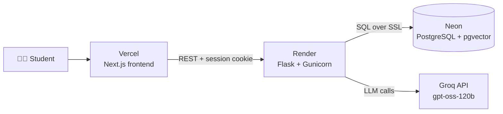
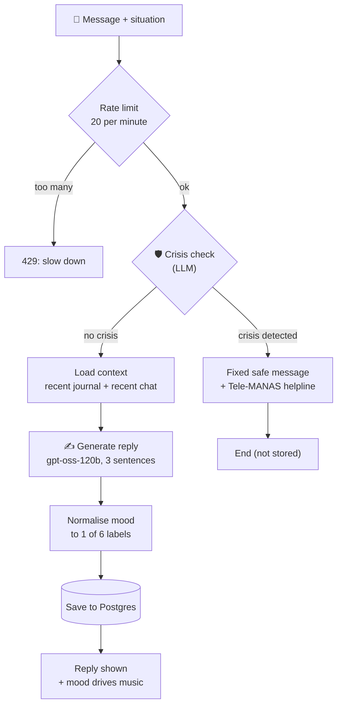
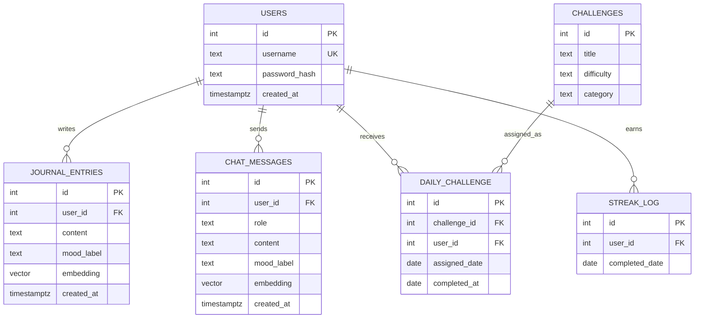

<div align="center">

# 🌟 VibeVerse

### An AI companion that helps introverted and socially anxious students find their voice

Chat with an empathetic AI, journal your day, track your mood, and build confidence with small daily challenges, all in a private, judgment-free space.

[](https://frontend-two-sepia-yhuaaettcp.vercel.app/)
[](https://vibeverse-yybw.onrender.com)


**[Demo](#-demo) · [Features](#-features) · [How it works](#-how-it-works) · [Tech stack](#%EF%B8%8F-tech-stack) · [Run locally](#-run-it-locally) · [Challenges](#-challenges-i-solved) · [Roadmap](#%EF%B8%8F-roadmap)**

</div>

> ⏳ The backend runs on a free tier and sleeps when idle, so the very first request can take up to a minute.

---

## 🎬 Demo

<p align="center">
  <a href="docs/demo.mp4">
    
  </a>
  <br>
  <sub>▶️ Click the preview to watch the full 2.5-minute walkthrough (login, challenges, journal, music, games, history, chat)</sub>
</p>

<!-- Optional upgrade: for an inline player, drag docs/demo.mp4 into the GitHub README editor (or any issue comment).
GitHub uploads it and gives you a https://github.com/user-attachments/assets/... link. Paste that link on its own line here. -->

### Screenshots

<table>
  <tr>
    <td align="center" width="50%">
      
      <br><b>AI chat that remembers your journal</b>
    </td>
    <td align="center" width="50%">
      
      <br><b>Private journal with mood tags</b>
    </td>
  </tr>
  <tr>
    <td align="center">
      
      <br><b>Daily challenge and streak</b>
    </td>
    <td align="center">
      
      <br><b>Mood-based music with Spotify player</b>
    </td>
  </tr>
  <tr>
    <td align="center">
      
      <br><b>Confidence score and streak</b>
    </td>
    <td align="center">
      
      <br><b>Chat history and mood summary</b>
    </td>
  </tr>
</table>

<!-- 📸 Still to add (optional): the safety response with the Tele-MANAS helpline.
Save it as docs/screenshots/crisis-support.png and add:
<p align="center"><br><b>Safety response with helpline</b></p>
-->

---

## ✨ Features

| | Feature | What it does |
|---|---|---|
| 💬 | **Context-aware AI chat** | Replies in exactly 3 short sentences: acknowledge the feeling, give one action to try right now, end with encouragement. Adapts to where you are (class, canteen, first day, group project, presentation). |
| 🧠 | **Memory of your journal** | The bot brings in your recent journal entries and chat turns, so a message like "I feel behind today" connects to the exam stress you wrote about. |
| 🎭 | **Mood detection** | Every reply is tagged with one of six moods: very anxious, nervous, confused, sad, okay, confident. |
| 🛡️ | **Crisis safety branch** | If a message signals self-harm or acute danger, the AI is skipped entirely. A fixed message with the Tele-MANAS helpline (14416 / 1800-89-14416) is shown instead. |
| 📔 | **Journal** | Write, view and delete private entries with a mood tag. |
| 🎯 | **Daily challenges and streaks** | 12 small social challenges (easy, medium, hard). Complete one a day to grow your streak. |
| 🎧 | **Mood-based music** | A Spotify playlist matched to your mood, with language filters (English, Hindi, Punjabi, Instrumental) and a box to paste your own Spotify link. |
| 🎮 | **Calming games** | Breathing exercise, bubble pop and memory match for a quick mental reset. |
| 📈 | **History and progress** | Past chats, mood counts and a confidence score built from mood, streak and challenge completion. |
| 🔐 | **Accounts and privacy** | Hashed passwords, session cookies, and every query scoped to the logged-in user. |
| 🚦 | **Rate limiting** | 20 chat messages per minute per user to protect the API budget. |

---

## 🧭 How it works

### System architecture



### What happens when you send a message



<details>
<summary><b>🔍 Click to read the step-by-step explanation</b></summary>

1. **Rate limit.** Flask-Limiter allows 20 chat requests a minute per user.
2. **Crisis check.** One short LLM call decides if the message signals self-harm or acute danger. This is the safety gate and it runs before anything else.
3. **Safe path.** If flagged, a fixed, human-written message with verified Indian helpline numbers is returned. No generated text is used.
4. **Context.** For normal messages, the user's recent journal entries and last few chat turns are loaded (always filtered by `user_id`).
5. **Generation.** The model writes a 3-sentence reply using the place, the context and the message, and picks a mood.
6. **Normalisation.** Any mood word the model returns is mapped onto the six allowed moods, so the UI and music never break.
7. **Persistence.** Both messages are stored with the mood label.

</details>

### Data model



---

## 🛠️ Tech stack

| Layer | Technology | Why |
|---|---|---|
| **Frontend** | Next.js, React, Tailwind CSS, shadcn/ui | Fast pages, simple routing, deployed on Vercel |
| **Backend** | Flask, Gunicorn, Flask-CORS, Flask-Limiter | Small, readable API that runs well in Docker |
| **AI orchestration** | LangGraph, LangChain | A graph with a crisis branch is clearer than a linear chain |
| **LLM** | `openai/gpt-oss-120b` on Groq | Very fast replies with structured output |
| **Database** | PostgreSQL on Neon + pgvector | One database for users, journal, chat and vectors |
| **Embeddings** | sentence-transformers (bge-small, 384 dims) | Vector columns are ready for semantic search (see roadmap) |
| **Auth** | Werkzeug password hashing, Flask sessions | Secure cookies, HttpOnly, SameSite handling in production |
| **DevOps** | Docker, Docker Compose, GitHub | Same container locally and on Render |
| **Hosting** | Vercel, Render, Neon | All free tiers |

---

## 💡 Engineering highlights

- **Safety first, by design.** The crisis check is a separate graph step that bypasses the LLM, and the helpline numbers were verified against Government of India sources.
- **Graph, not a chain.** LangGraph models the real branching logic (safe path vs normal path) so it is easy to extend.
- **Structured output.** The model returns a typed object (reply, mood, memory flag), and a normaliser makes the app robust to unexpected mood words.
- **Per-user isolation.** Every database query filters by `user_id`, and I tested that a second account cannot see the first account's data.
- **Honest failure handling.** The UI shows real errors instead of fake fallback replies.
- **Built for a tight budget.** Lazy model loading, one Gunicorn worker and a rate limiter keep it running on a 512 MB free instance.
- **Deploys from three platforms.** Frontend, backend and database are separate services wired together with environment variables and CORS.

---

## 🐛 Challenges I solved

<details>
<summary><b>Groq retired my model</b></summary>

Chat suddenly returned a 404 `model_not_found`. Groq had retired `llama-3.3-70b-versatile` on Aug 16, 2026. I moved to `openai/gpt-oss-120b`. Lesson: check the provider's deprecation page when a working model fails.

</details>

<details>
<summary><b>pgvector: <code>operator does not exist: vector &lt;=&gt; numeric[]</code></b></summary>

Saving embeddings worked, searching did not, because Postgres did not know the list of numbers was a vector. The fix was an explicit `::vector` cast in every similarity query.

</details>

<details>
<summary><b>Fake replies were hiding real crashes</b></summary>

The first frontend showed canned advice whenever the backend failed, so broken messages looked normal. I removed the canned replies and show a clear error bubble instead.

</details>

<details>
<summary><b>The AI picked moods my code didn't expect</b></summary>

Words like "exhausted" and "awkward" crashed a strict list of six moods. The reply now accepts any word and maps it to one of the six with a synonym table.

</details>

<details>
<summary><b>Unrelated memories kept appearing</b></summary>

A message about feeling awkward in the canteen pulled in an old journal story. I tightened the prompt (3 sentences, no dates, only use memory when it is about the same topic) and added a minimum similarity threshold during the semantic-search phase.

</details>

<details>
<summary><b>Login hung after deploying to Render</b></summary>

Requests stayed pending with no response. The free 512 MB instance could not hold PyTorch plus an embedding model. I made the model load lazily, stopped generating embeddings on save, used recent entries as chat context, and ran one Gunicorn worker. This was a resource ceiling, not a logic bug.

</details>

<details>
<summary><b>Journal dates showed "Invalid Date"</b></summary>

The rebuilt backend renamed fields the frontend still expected. The API now returns `mood_tag` and an ISO `timestamp`, and journal saves are verified instead of silently faked.

</details>

---

## ⚠️ Limitations

Being upfront about what this project is not:

- **Not a medical or therapy tool.** It is a supportive companion and says so in the app. It does not replace professional help.
- **Chat memory uses recent entries.** Semantic search is paused to fit free hosting, so an older but relevant journal entry can be missed.
- **Mood is an AI guess** and can be wrong, which affects the music pick.
- **Safety is one AI check plus a fixed message.** Indirect crisis phrases need more testing, and a keyword backup layer is planned.
- **Free tier behaviour.** The backend sleeps when idle, and rate-limit counters reset on restart.
- The Progress page charts are still basic.

---

## 🗺️ Roadmap

- [x] Auth, journal, challenges, streaks, music, history
- [x] LangGraph chat flow with crisis branch
- [x] Per-user data isolation
- [x] Deployed on Vercel, Render and Neon
- [ ] Restore semantic memory search with a lightweight embedding model and backfill old entries
- [ ] Evaluation set (about 20 test messages) to measure memory quality and tune thresholds
- [ ] Keyword backup layer for indirect crisis phrases
- [ ] Real mood and journal trend charts on the Progress page
- [ ] Redis-backed rate limiting for multi-worker setups
- [ ] Voice input and a mobile-friendly PWA

---

## 🚀 Run it locally

**Prerequisites:** Docker Desktop, Python 3.12, Node.js 20+, a free [Groq API key](https://console.groq.com).

<details open>
<summary><b>Backend</b></summary>

```bash
git clone https://github.com/heena-jindal/VibeVerse.git
cd VibeVerse/backend

# 1. Start Postgres with pgvector (creates all tables from schema.sql)
docker compose up -d

# 2. Python environment
python -m venv venv
venv\Scripts\activate          # macOS/Linux: source venv/bin/activate
pip install -r requirements.txt

# 3. Configure environment
cp .env.example .env           # Windows: copy .env.example .env
# then fill in GROQ_API_KEY and SECRET_KEY

# 4. Run
python app.py                  # http://127.0.0.1:5000
```

</details>

<details open>
<summary><b>Frontend</b></summary>

```bash
cd VibeVerse/frontend
npm install

# create frontend/.env.local
# BACKEND_URL=http://localhost:5000
# NEXT_PUBLIC_APP_NAME=VibeVerse

npm run dev                    # http://localhost:3000
```

</details>

<details>
<summary><b>🔑 Environment variables</b></summary>

| Where | Variable | Purpose |
|---|---|---|
| Backend | `DATABASE_URL` | Postgres connection string (Neon needs `?sslmode=require`) |
| Backend | `GROQ_API_KEY` | LLM access |
| Backend | `SECRET_KEY` | Signs session cookies |
| Backend | `FRONTEND_URL` | Allowed origin for CORS (no trailing slash) |
| Backend | `IS_PRODUCTION` | `true` on Render for secure cookies |
| Backend | `PORT` | Port the container listens on |
| Frontend | `BACKEND_URL` | Where the frontend sends API calls |

Never commit real values. `.env` and `.env.local` are in `.gitignore`.

</details>

<details>
<summary><b>☁️ Deploying</b></summary>

1. **Neon:** create a project, run `schema.sql` in the SQL editor, copy the connection string.
2. **Render:** new Web Service from this repo, root directory `backend`, runtime Docker, add the backend variables above.
3. **Vercel:** import this repo, root directory `frontend`, set `BACKEND_URL` to the Render URL, deploy.
4. Set `FRONTEND_URL` on Render to the final Vercel URL and redeploy.

</details>

---

## 📡 API reference

<details>
<summary><b>Click to expand the endpoints</b></summary>

| Method | Route | Auth | Description |
|---|---|---|---|
| POST | `/api/register` | No | Create an account |
| POST | `/api/login` | No | Log in, sets session cookie |
| POST | `/api/logout` | Yes | Clear session |
| GET | `/api/login/check` | No | Is the user logged in |
| POST | `/api/chat` | Yes | Send a message (`message`, `situation`), rate limited |
| GET | `/api/history` | Yes | Recent chats and mood counts |
| GET / POST | `/api/journal` | Yes | List or add journal entries |
| DELETE | `/api/journal/<id>` | Yes | Delete an entry |
| GET | `/api/challenge/today` | Yes | Today's challenge and streak |
| POST | `/api/challenge/complete` | Yes | Mark it done |
| GET | `/api/progress` | Yes | Confidence score and stats |
| GET | `/api/music` | Yes | Playlist for the latest mood |

</details>

---

## 📁 Project structure

<details>
<summary><b>Click to expand</b></summary>

```
VibeVerse/
├── backend/
│   ├── app.py              # Routes, sessions, CORS, rate limiting, health check
│   ├── auth.py             # Register, login, login_required
│   ├── database.py         # Challenges, streaks, progress score
│   ├── schema.sql          # All table definitions
│   ├── Dockerfile          # Gunicorn, 1 worker, 2 threads
│   ├── docker-compose.yml  # Local Postgres + pgvector
│   ├── requirements.txt
│   └── rag/
│       ├── graph.py        # LangGraph flow, prompt, mood normaliser, crisis message
│       ├── retriever.py    # Chooses context for the prompt
│       ├── vector_store.py # Journal and chat database access
│       ├── embeddings.py   # Lazy-loaded embedding model
│       └── schemas.py      # Structured output models
├── frontend/
│   ├── app/                # chat, journal, challenges, music, games, progress, history, login, register
│   ├── components/
│   └── lib/
└── docs/
    ├── demo.mp4            # full walkthrough video
    ├── demo-preview.gif    # preview shown in this README
    └── screenshots/        # app screenshots
```

</details>

---

## 🧪 How I tested it

<details>
<summary><b>Manual test checklist</b></summary>

- Sign up, duplicate username, wrong password, correct login, stay logged in after refresh, logout
- Journal: add, view with real date and mood, delete, empty entry rejected
- Chat memory: a journal entry about an exam is picked up by "I feel so behind today"
- No memory leakage: an unrelated question ("what's a good snack?") gets a normal answer
- Situation buttons change the reply (canteen vs presentation)
- Mood words like "exhausted", "awkward", "lonely", "proud" all work
- Safety: crisis phrases return the fixed helpline message, casual phrases ("this exam is killing me lol") do not
- Privacy: a second account cannot see the first account's journal
- Rate limit returns a clear error, and stopping the backend shows an honest error bubble
- Data check: rows land in Neon with mood labels

</details>

---

## 👩‍💻 About the author

**Heena Jindal**: B.Tech student building AI products end to end, from LLM pipelines to deployment.

<!-- Add your links:
[](https://www.linkedin.com/in/YOUR-PROFILE)
[](mailto:YOUR-EMAIL)
[](https://YOUR-PORTFOLIO)
-->

[](https://github.com/heena-jindal)

---

<div align="center">

If this project helped or interested you, a ⭐ on the repo means a lot.

*Built with care for introverted souls everywhere.*

</div>

<!-- Add a LICENSE file (for example MIT) and link it here if you want others to reuse the code. -->
